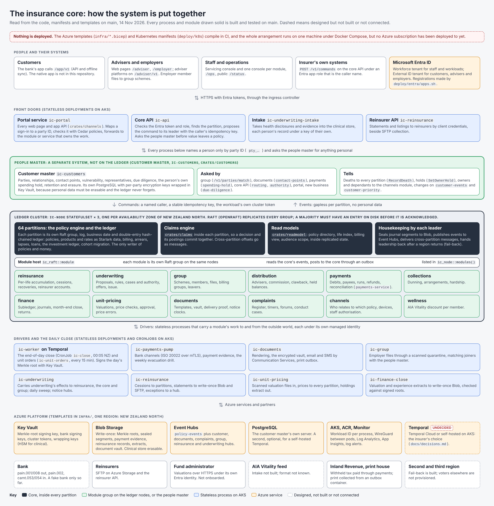

# Insurance core

A core policy administration and ledger system for a life and health insurer, written in Rust and built to run on Azure.

It issues and services policies (retail term life, health, and group schemes), bills and collects premiums, matches incoming payments, runs the daily close, and keeps a double-entry ledger whose every entry is hash-chained, replicated and provable after the fact.

## How it is put together



Every process is built and tested on main. Nothing has been deployed to Azure yet: the templates compile and the manifests render in CI, and the whole arrangement runs on one machine under Docker Compose.

| Process | What it does | Runs as |
| --- | --- | --- |
| `ic-node` | A ledger node. Holds a replica of every partition's Raft group (the log, the policy state, the ledger, claims and the read models) and of every module's group (`ic_node::modules()`: reinsurance, underwriting, group, distribution, payments, collections, finance, unit pricing, documents, complaints, channels, wellness). | StatefulSet of three on AKS, one per zone |
| `ic-api` | The core API. A stateless gateway that checks the caller's Entra token and role and routes each command to the partition that owns the policy. | Deployment |
| `ic-portal` | Every web page and app API: the customer app's API and sync, the adviser and employer portals, the staff and operations consoles, the status page (`crates/channels`, `docs/channels.md`). | Deployment |
| `ic-customers` | The customer master (people master): who every person and organisation is, on its own PostgreSQL, separate from the ledger so personal data can be erased (`docs/customers.md`). | Deployment |
| `ic-worker` | The end-of-day close as a Temporal workflow, so a close survives any process dying part-way, and unit orders between closes. | Deployment, and CronJobs `ic-close` and `ic-unit-orders` |
| `ic-payments-pump` | The bank channels, payment evidence and the evacuation drill (`docs/payments.md`). | Deployment, and CronJob `ic-payments-drill` |
| `ic-documents` | Rendering, the document vault, email, SMS and print, proof of delivery (`docs/documents.md`). | Deployment |
| `ic-group` | Employer files and scheme administration's outside work (`docs/group.md`). | Deployment |
| `ic-underwriting`, `ic-underwriting-intake` | Underwriting's driver, and the intake for health disclosures into the clinical store (`docs/underwriting.md`). | Deployments |
| `ic-reinsurance` | Carries reinsurance's cessions to the partitions, statements to write-once storage and SFTP, and serves the reinsurer API (`docs/reinsurance.md`). | Deployment |
| `ic-unit-pricing` | Valuation files in, prices to every partition, holdings extract out (`docs/unit-pricing.md`). | Deployment |
| `ic-finance-close` | Finance's month-end close and its write-once extracts (`docs/finance.md`). `ic-finance-tables` validates rate tables. | Deployment; tool |
| `ic-admin` | The operator's command: bootstrap, status, membership changes, the insurer's set-up file, the configuration register, policy migration. | Suspended CronJob run by hand, and Job `ic-bootstrap` |
| `ic-simulate` | A synthetic insurer that runs a year of business in seconds, for sizing and soak runs. | Developer tool |

Azure services do the work that should not be ours:

| Need | Azure service |
| --- | --- |
| Identity for every process, no secrets | Entra Workload ID, a managed identity per workload |
| Caller identity on the API | Entra ID tokens |
| Tamper evidence: daily Merkle roots and sealed journal segments | Blob Storage with version-level immutability |
| Signing the daily root | Key Vault (or Managed HSM) |
| Clinical records, erasable per person | Key Vault key wrapping, a Blob container with no retention |
| Events for downstream systems | Event Hubs, one hub partition per ledger partition |
| Each workload's cluster token | Key Vault secret `cluster-token-<workload>`, mounted through the Secrets Store CSI driver |
| Personal data, erasable per person | Azure Database for PostgreSQL for the customer master, each party's key wrapped in Key Vault |
| Email and SMS with delivery reports | Communication Services and Event Grid |
| Files from outside (employer files, valuations) | Blob Storage scanned by Defender for Storage |
| Bank keys and credentials | A Key Vault of payments' own |
| Logs, metrics and alerts | Container Insights, Application Insights and log alert rules (JSON lines on stdout) |

What each template creates is drawn in [docs/architecture/azure-deployment.png](docs/architecture/azure-deployment.png). Temporal hosting (Temporal Cloud or self-hosted on AKS) is still the insurer's decision.

## Documentation

- [docs/architecture.md](docs/architecture.md): how the system works, the diagrams, and each area's state and hand-over.
- [docs/operations.md](docs/operations.md): the runbook, from the first deployment to replacing a node.
- [docs/decisions.md](docs/decisions.md): what is deliberately not done yet, open decisions and best-estimate placeholders.
- [docs/integration.md](docs/integration.md): fitting the core into an insurer's existing systems, and what can be swapped.
- [docs/modules.md](docs/modules.md): the contract for modules built beside the core.
- One document per area: [claims](docs/claims.md), [reinsurance](docs/reinsurance.md), [underwriting](docs/underwriting.md), [group schemes](docs/group.md), [commission](docs/distribution.md), [payments](docs/payments.md), [documents](docs/documents.md), [complaints](docs/complaints.md), [finance](docs/finance.md), [unit pricing](docs/unit-pricing.md), [customer master](docs/customers.md), [portal and app services](docs/channels.md), [wellness](docs/wellness.md), [AIA New Zealand products](docs/aia-products.md), [design system](docs/design-system.md).
- Testing: [the persona test pack](docs/testing/personas/README.md) and [the persona end-to-end suite](e2e/README.md).

## Try it

One process, everything in memory, no Azure:

```sh
IC_AUTH=dev IC_OPENING_DATE=2027-11-15 cargo run --bin ic-api
curl -s localhost:8080/readyz
```

The whole production arrangement on one machine (three ledger nodes, Temporal, two workers, the API), then broken on purpose:

```sh
deploy/compose/chaos.sh          # build, run the failure drill, tear down
KEEP=1 deploy/compose/chaos.sh   # leave the cluster up afterwards
```

On a laptop whose Docker machine has less than about 16 GiB, the release build runs out of memory. Build with the drill profile and fewer jobs, which a 7.7 GiB machine manages: `CARGO_PROFILE=drill CARGO_BUILD_JOBS=3 deploy/compose/chaos.sh`. The same cap works for the checks in an image: `docker build --target test --build-arg CARGO_BUILD_JOBS=3 .` (the test stage no longer needs the release build first).

## Build and test

Needs Rust (the toolchain is pinned in `rust-toolchain.toml`), `clang`, `protoc` and the protobuf well-known types (`protobuf-compiler` and `libprotobuf-dev` on Debian).

```sh
cargo fmt --all --check
cargo clippy --workspace --all-targets --locked -- -D warnings
cargo test --workspace --locked
python3 tools/check_rounding.py
python3 tools/check_test_docs.py
```

The end-of-day workflow test needs a Temporal server. It uses the one at `IC_TEST_TEMPORAL_ADDRESS` if set, otherwise it starts the dev server executable named by `IC_TEST_TEMPORAL_EXE`; with neither it fails and says what to set. `IC_SKIP_TEMPORAL_TESTS=1` leaves it out, and says so in the output.

The standards the suite is held to, enforced in CI (`.github/workflows/ci.yml`, and `drill.yml` for the failure drill):

- Line coverage of at least 98% as `cargo llvm-cov --workspace` reports it (its own table, which counts a line again for each generic instantiation and enclosing closure), with the Temporal tests included. `tools/coverage_floor.py` lists the uncovered lines of each file.
- Every test carries a `Purpose:` and a `Why it matters:` line. `tools/check_test_docs.py` fails the build otherwise.
- Resilience is tested, not assumed: ledger node processes are killed mid-write, disks are destroyed, workers die mid-close, Azure goes away.

## Deploy to Azure

1. Create the platform: `az deployment group create -g <rg> -f infra/main.bicep -p infra/main.bicepparam`, then issue each workload's cluster token.
2. Deploy each module's own template (`infra/customers.bicep`, `documents`, `finance`, `group`, `reinsurance`, `underwriting`, `unit-pricing`) into the same resource group.
3. Build and push the image to the registry `main.bicep` created, and register the applications with Entra ID.
4. Fill in `deploy/k8s` from the deployments' outputs and `kubectl apply -k deploy/k8s`; the bootstrap job forms the groups and opens the first business date.
5. Apply the insurer's set-up file with `ic-admin apply`.

[docs/operations.md](docs/operations.md) has each step in full.

## Repository layout

```
crates/money       exact decimal money; the only crate that rounds
crates/ledger      double-entry ledger, hash chain, Merkle roots
crates/log         the ordered command log of one partition
crates/product     product definitions (Starlark), rating, schedules
crates/core        the policy state machine: issue, bill, collect, lapse, loans, units, transfer, migration, close
crates/readmodel   policy directory, life index, billing view, audience scope
crates/cashmatch   matching incoming payments to policies
crates/raft        Raft groups, storage, transport, the module host, access grants, fail-back
crates/node        the deployed ledger node (ic-node) and the list of hosted modules
crates/workflows   the end-of-day close and unit orders, as Temporal workflows (ic-worker)
crates/azure       Blob Storage, Key Vault and Event Hubs adapters
crates/entra       the one Entra token check every service uses
crates/api         the core API, the gateway, ic-admin and policy migration
crates/sim         in-process cluster and the synthetic insurer
crates/claims      intake, assessment, decisions and authority, benefits in payment, overpayments (inside each partition)
crates/reinsurance treaties, per-life accumulation, cessions, capacity, recoveries, reinsurer accounts, the reinsurer API
crates/underwriting proposals, disclosure, rules, case work and authority, offers, issue, the clinical store
crates/group       scheme administration, employer files, billing groups, leavers
crates/distribution advisers, licence status, commission, clawback, statements, the held balance workbench
crates/payments    direct debits, payee accounts, payment runs, refunds, bank reconciliation
crates/payments-service the payments module's host, bank channels, the pump (ic-payments-pump), payment evidence
crates/collections dunning, arrangements and hardship
crates/finance     the finance ledger, month-end close, returns, rate table validation
crates/pricing     unit pricing: valuations, price checks, approval, price errors, holdings extract
crates/documents   templates, issuing, the document vault, delivery and proof, notice clocks and defects
crates/complaints  complaints, disputes and conduct cases: the register, timers, external forums, reporting
crates/customers   the customer master (people master), on its own PostgreSQL
crates/channels    the customer app API, adviser and employer portals, staff and operations consoles, the status page (ic-portal)
crates/wellness    the AIA Vitality discount
products/          the shipped products, definitions and rate tables
treaties/          the shipped reinsurance treaties and reinsurer rate tables
config/            Cedar access policies, commission and finance configuration
infra/             the Azure platform (Bicep): main.bicep and one template per module
deploy/compose     the cluster on one machine, and the failure drill
deploy/k8s         the cluster on AKS
deploy/entra       app registrations and roles
deploy/cluster-access  per-workload cluster tokens and grants
e2e/               the persona end-to-end suite through the web pages
tools/             build checks, the persona matrix generator, diagram rendering, the CI runner image
docs/              architecture, operations, decisions, each area's document, the persona test pack
```
