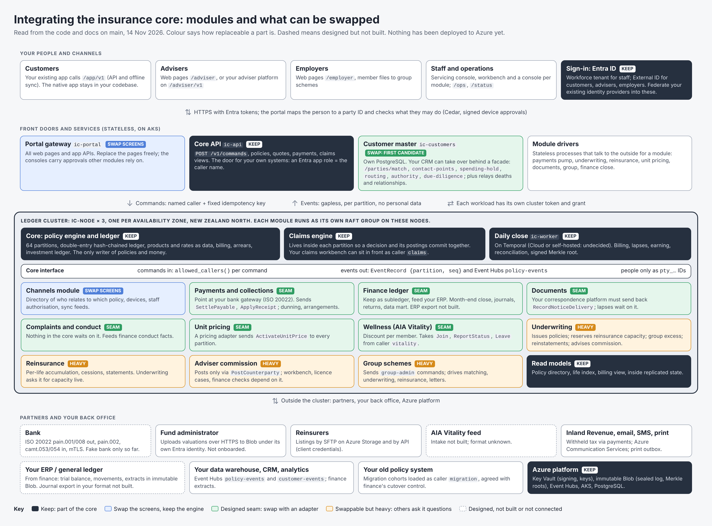

# Integrating the core with existing systems

This page is for whoever has to fit the insurance core into an insurer's existing estate. It says what the core is made of, how each part talks to the rest, and for each part whether a system you already run could take its place, what that system would have to do, and what cannot be removed. It is drawn from the code and from `architecture.md`, `modules.md`, `decisions.md`, `operations.md`, `customers.md` and `aia-products.md` as they stood on 14 November 2026.

## The one rule that makes swapping possible

Every part of the system other than the core knows the core only through three things, and so can any system of yours:

1. **Commands in.** A part changes a policy or moves money only by sending the core a typed command as a named caller (`new-business`, `payments`, `group-admin`, `claims` and so on), with an idempotency key that never changes for the same intent. Inside the cluster that goes through `ClusterClient`; from outside it is `POST /v1/commands` on `ic-api` with an Entra ID token whose app role is the caller name. The core checks each command against `allowed_callers()` in `crates/core/src/command.rs`, so a replacement system takes over a caller name, not a code path.
2. **Events out.** Each of the 64 partitions publishes a gapless ordered stream of events (`EventRecord { partition, seq }`). Modules on the nodes read it directly; anything outside reads the Event Hubs hub `policy-events` or the node's event routes with a checkpoint per partition. Events carry no personal or health data, only opaque IDs.
3. **People by party ID.** The core never holds a name, address or date of birth. It holds `pty_…` IDs, and whoever needs the person asks the customer master.

A part that is replaced therefore has two jobs: send the commands that part used to send, and answer the questions other parts used to ask it. The tables below list both for each part.

## What cannot be removed

These are the system. Replacing any of them means not using this core.

| Part | Crates | Why it stays |
|---|---|---|
| Policy engine and ledger | `core`, `ledger`, `log`, `money`, `product` | The only thing that writes policies or money. Double entry, hash-chained, replayable. Products and rate tables are Starlark data activated through the log. |
| Ledger nodes | `raft`, `node` | Three-node Raft cluster (one per availability zone) holding every partition and hosting every module. |
| Claims engine | `claims` | Not a separate service: claims state lives inside each policy's partition (`CoreState::claims`) so a claim's decision and its postings commit together. You can put your own claims workbench in front of it (as caller `claims`), but the assessment, reserves and payments to the ledger stay here. |
| Daily close | `workflows` (`ic-worker`) on Temporal | Billing, arrears, lapses, earning, reconciliation and the signed Merkle root each night. Where Temporal runs (Temporal Cloud or self-hosted on AKS) is still an open decision. |
| Read models | `readmodel` | Policy directory, life index and billing view, kept inside the replicated state. |
| Azure adapters | `azure`, `entra` | Key Vault signs the daily Merkle root, Blob holds sealed log segments and roots (immutable), Event Hubs carries events out. `ic-entra` is the one token validator. |

Identity is fixed to Entra in the sense that every service checks Entra-issued tokens. Your existing identity provider does not have to go: staff sign in through the workforce tenant (which can federate with your existing directory), and customers, advisers and employers through an Entra External ID tenant, which can federate with an existing customer identity provider over OIDC or SAML. The portal binds the signed-in subject to a party ID, so the token says who someone is and the core decides what they may do.

## Each module, and what can be swapped

The verdicts use four levels, matching the colours in the diagram:

- **Keep**: part of the core, above.
- **Swap the screens**: keep the engine, use your own front end.
- **Designed seam**: the contract is narrow and documented; an existing system can take over with an adapter.
- **Swappable, heavy**: possible, but several other parts read from it or ask it questions, and all of those would need re-pointing.

### Customer master (`ic-customers`): designed seam, the first swap candidate

Who a person or organisation is: parties, relationships, matching, contact points, vulnerability markers, representatives, due diligence, the customer's own spending hold, retention and erasure. A stateless HTTP service with its own PostgreSQL, not on the ledger, because personal data must be erasable. The design notes assumed the bank's platform supplied this; it was built because nothing did.

| | |
|---|---|
| Others ask it | `POST /v1/parties/match` (group schemes), `GET /v1/parties/{id}/contact-points` (documents), `GET /v1/parties/{id}/spending-hold` (payments), `GET /v1/parties/{id}/routing` and `/authority` (the core API before value leaves a policy), `GET /v1/parties/{id}/due-diligence` (new business and servicing) |
| It sends | Every death to every partition as claims `RecordDeath` / `RetractDeath` (caller `customer-master`); owners, assignees and dependants to the portal's directory (`RecordOwnership` and friends); `SetOwnerHold` to the core; events on hubs `customer-events` and `customer-priority` |
| To replace it | Put a facade over your CRM or party master that answers those six routes in the same shapes (`docs/customers.md`), keeps the `pty_…` IDs stable, and pushes deaths and relationship changes as the two relays do. Matching bands (80/40) and group's test of them move with it. |
| Status | Built and tested against PostgreSQL. Not deployed. |

### Portal and app services (`ic-channels`, `ic-portal`): swap the screens

The channel module on the nodes (who relates to which policy, devices and signed approvals, staff authorisation in Cedar, per-party feeds for offline sync) and the gateway with its web pages: `/adviser`, `/employer`, `/staff`, `/ops`, and staff consoles for pricing, complaints, finance, claims, reinsurance, commission, underwriting, payments and group. The customer app is an API and sync protocol only (`/app/v1`); the native app belongs in your existing app codebase.

| | |
|---|---|
| APIs it offers | `/app/v1` (customer app), `/adviser/v1`, `/employer/v1`, `/staff/v1`, `/ops/v1`, `/internal/v1`; RFC 9457 problems; `Idempotency-Key` on every write |
| To replace the screens | Call the same routes from your own adviser, employer or staff front ends. Nothing in the engine depends on the pages. |
| To replace the module | Much harder: the staff consoles are the only way people send other modules' commands with Cedar checks, device-signed approvals and two-person sign-offs, and the commission workbench lives here. Your replacement would have to send each module's console commands under the console caller names and enforce the same approvals. |
| Status | Built, browser-checked. Not deployed. |

### Payments and bank channels (`ic-payments`, `ic-payments-service`, `ic-collections`, `cashmatch`): designed seam on the bank side

Payment runs, refunds, direct debit collections, returns, AML on third-party payers, withheld tax to Inland Revenue, sweeps between statutory funds; collections (dunning, arrangements, hardship); cash matching of incoming money to policies.

| | |
|---|---|
| Talks to the core | `SettlePayable` (caller `payments`), `ApplyReceipt` (`cash-matching`), `ApplyMemberReceipt`, `RemitWithholding`, `PayeeDebt`; arrangements and hardship as `collections` |
| Others ask it | Anyone pays through `prepare_run` + `add_run_items` or `request_refund` and hears back `item_settled` / `item_returned`; claims (`claim_paid`, `ConfirmRun`, `PaymentReturned`), reinsurance (`offer_payment`, `record_settlement`), finance close (`fund_cash_settlement`, aged unidentified receipts) |
| The bank | ISO 20022 (pain.001 and pain.008 out, pain.002, camt.053 and camt.054 in) over mTLS; per-channel format setting. No SFTP channel. **Only a fake bank has ever been connected.** |
| To replace it | Easiest route: keep the module and point its channel at your existing payments hub or bank gateway, which already speaks ISO 20022. Full replacement means your payments system sends the five core commands above with the bank's end-to-end reference as the payment or receipt ID, and takes over claims' and reinsurance's settlement messages and the two finance close answers. |
| Status | Built. Not deployed. No real bank. |

### Finance ledger and reporting (`ic-finance`): designed seam, keep as subledger

Books from the core's events, daily control check against the Merkle roots, maker-checker journals, month-end close with automatic checks from every module, returns, conduct reporting, a data mart and its extracts (in force, movement, experience).

| | |
|---|---|
| Reads | The core's events; Merkle roots from Blob; each module's close check and aged items (`ReportCheck`, `ReportAgedItems`) |
| Writes | Extracts to the immutable container `finance-extracts` |
| Fitting your ERP | The intended shape is to keep this as the insurance subledger and feed your general ledger from it: trial balance and movements are questions to the module, extracts are files. **A journal export in your ERP's format is not built**; it is the piece to add. |
| To replace it | Possible from `policy-events` alone (the events are complete), but your system would then own the chart mapping (`config/finance/chart.star`), the close checks every module answers, and reconciliation to the Merkle roots. Not recommended. |
| Status | Built, Temporal close tested in CI. Not deployed. |

### Documents and correspondence (`ic-documents`): designed seam

Templates approved by legal, product and compliance; rendering and PDF; the encrypted vault; email, SMS, in-app and print; mandatory notices with proof of delivery.

| | |
|---|---|
| Talks to the core | `RecordNoticeDelivery` and `OpenReopenWindow` (caller `documents`); `RecordRepaymentLetter` to claims. The core will not lapse a policy before the earliest effect of its latest lapse notice, so the notice clock matters. |
| Others ask it | `request_letter` from group, underwriting and claims; triggers from core events |
| Outside | Azure Communication Services (email and SMS), a print house outbox |
| To replace it | Your existing correspondence platform can render and send, but it must answer every trigger the core's events raise, read contact points from the customer master, and send back `RecordNoticeDelivery` with proof of delivery for mandatory notices. Without that the lapse rules stop working. |
| Status | Built. All 27 templates carry draft wording marked for legal review and cannot be activated until legal rewrites them. Not deployed. |

### Complaints and conduct (`ic-complaints`): designed seam, easy

Complaints register with timers and escalation, referral to the scheme and regulators, conduct cases including adviser licence events.

| | |
|---|---|
| Others depend on it | Finance reads `RecordConductFacts`; the documents service relays licence cases from commission; the portal's `/complaints` console |
| To replace it | Your complaints system receives licence cases from the commission module and sends conduct facts to finance. Nothing in the core waits on it. |
| Status | Built. Real timer values need compliance. Not deployed. |

### Unit pricing (`ic-pricing`): designed seam

Valuation intake, price strike, checks, maker-checker, publishing prices to every partition, price error correction, holdings extract.

| | |
|---|---|
| Talks to the core | `InvestCommand::ActivateUnitPrice` to every partition (caller `unit-pricing`); reads `UnitOrderExecuted`, `UnitOrderReplayed`, `FundActivated` |
| Outside | The fund administrator uploads valuation CSVs over HTTPS to Blob under its own Entra service principal (Mitchell, 12 Nov). Holdings extract written to an immutable container. |
| To replace it | If your fund administrator already strikes prices, a small adapter can send `ActivateUnitPrice` per partition with the same IDs and supersede rules. Finance's close check `unit_pricing` and the holdings extract would then be yours. |
| Status | Built, tested end to end against a real node. `infra/unit-pricing.bicep` is not referenced by `main.bicep`; no administrator onboarded. |

### Underwriting and new business (`ic-underwriting`): swappable, heavy

Proposals from quote to issue for every entry point (new business, increase, alteration, reinstatement, group excess), disclosure, versioned rules, referral and authority, evidence, interim cover.

| | |
|---|---|
| Talks to the core | `IssuePolicy`, `IssueQuoted`, `AddUnderwrittenLayer`, `AlterUnderwrittenTerms`, `AvoidPolicy`, `VaryForNonDisclosure` |
| Others depend on it | Reinsurance (capacity reserve and confirm, facultative terms); group (excess proposals `grp-uw:…`); collections (reinstatements needing underwriting); commission (`advise_new_business`); documents (letters) |
| Outside | Disclosure intake service; event hubs for evidence orders and delegated authority. Provider and delegate adapters are not built. |
| To replace it | Your rules engine (an automated underwriting system) can issue through the core as `new-business` / `underwriting`, but it must also reserve and confirm reinsurance capacity, take group excess and reinstatement cases, and advise commission. A lighter path: keep this module and call your rules engine from it. |
| Status | Built. Not deployed. |

### Reinsurance (`ic-reinsurance`): swappable, heavy

Treaties and rate tables as data, per-life accumulation across partitions, cessions, facultative, claim notices, statements and settlement, bordereaux.

| | |
|---|---|
| Talks to the core | `record_cession`, `post_reinsurance` (caller `reinsurance`); reads the event feed and claims facts |
| Others depend on it | Underwriting asks it for capacity; group sends scheme terms; payments settles its statements; finance asks `sweep_check` |
| Outside | Reinsurers get listings by SFTP (Azure Storage local users) and by an API with their own app registration (Mitchell, 13 Nov) |
| To replace it | A reinsurance administration system can be fed from `policy-events` and post cessions as caller `reinsurance`, but it must answer underwriting's capacity question in real time and group's scheme terms. |
| Status | Built. Treaties in `treaties/` are synthetic. Not deployed. |

### Adviser commission and held balances (`ic-distribution`): swappable, heavy

Adviser structure and licences, commission rules, earning and clawback from the core's events, statements, the held balance workbench, replacements.

| | |
|---|---|
| Talks to the core | `PostCounterparty` only; balances built from `CounterpartyPosted` |
| Others depend on it | Underwriting and group write layers into it; the portal's workbench and adviser directory; finance (`sweep_check`, aged held); complaints (licence cases); claims' overpayment memo lines |
| To replace it | A commission system can read `policy-events` and post through `PostCounterparty`, but the portal workbench, licence cases and finance checks would need re-pointing. |
| Status | Built. Not deployed. |

### Group scheme administration (`ic-group`): swappable, heavy

Scheme terms, member files from employers, membership, billing groups, excess cover, leavers and continuation, scheme split, health menu.

| | |
|---|---|
| Talks to the core | `ApplyMembership`, `AddExcessLayer`, `SplitScheme`, `SetMemberCovers`, `IssuePolicy` with `continuation_of`, cancel (caller `group-admin`) |
| Others it calls | Customer master (match), underwriting (excess), reinsurance (scheme terms), commission (broker layers), documents (absence letters) |
| To replace it | An existing scheme administration system can send the `group-admin` commands, but must match members through the customer master and drive the underwriting and reinsurance steps this module does. |
| Status | Built. Not deployed. |

### Wellness, AIA Vitality (`ic-wellness`): designed seam

Works out each member's Vitality discount and tells the core. Fed by the Vitality programme as caller `vitality` (`Join`, `ReportStatus`, `Leave`). **The intake from AIA is not built**, because the feed format is not known; when it is, a small service under its own Entra identity sends the three commands.

## External touchpoints

| Counterparty | How | State |
|---|---|---|
| Bank | ISO 20022 files over mTLS from payments | Fake bank only, by decision |
| Fund administrator | HTTPS upload to Blob under its own Entra service principal; malware scan tag gates intake | Built; not onboarded |
| Reinsurers | SFTP on Azure Storage, and an API with client credentials | Built; not deployed |
| AIA Vitality | Commands as caller `vitality` | Intake not built |
| Inland Revenue | Withheld tax remitted through payments (`RemitWithholding`) | Built |
| Email, SMS, print | Azure Communication Services; print house outbox | Built; domain and SMS number not set up |
| Your general ledger | From finance: trial balance and movements, extracts in Blob | ERP export not built |
| Your data warehouse or CRM | Event Hubs `policy-events`, `customer-events`; finance extracts | Built |
| Identity | Entra workforce tenant; Entra External ID for customers, advisers, employers; app registrations from `deploy/entra/apps.sh` | Built; not registered in a real tenant |
| Old policy system | Migration cohorts: `Command::Migration` as caller `migration` (`crates/api/src/migrate.rs`) | Built in the core |

## How to approach an integration

1. **Decide the identity and party seams first.** Federate your directories into Entra, and decide whether your existing CRM is the customer master (build the facade) or this one is. Everything else names people by the party ID that choice produces.
2. **Pick the money path.** Point payments at your existing bank gateway; decide how the finance subledger feeds your ERP.
3. **Decide the heavy swaps one at a time.** For each of underwriting, reinsurance, commission and group, list the questions other parts ask it (above). If your system cannot answer them, keep the module and integrate your system behind it.
4. **Give each replacement a caller and a token.** Each workload has its own cluster token and grant in `deploy/cluster-access/grants.json` (report mode today, to be enforced), or an Entra app role on `ic-api`.
5. **Read events, never state.** Downstream systems take `policy-events` and keep their own checkpoint per partition.

## What is designed but not yet built or deployed

- No Azure subscription has been deployed to. Every Bicep file compiles in CI; none has run against Azure.
- Cluster access is in report mode; enforcing it is a step in `operations.md`.
- A second region is designed in the software but has no infrastructure.
- Where Temporal runs is undecided.
- Not built: a real bank connection, the Vitality intake, the underwriting evidence-provider and delegate adapters, an ERP journal export, loading a new module's history from the cold tier.
- Rates for every AIA product and treaty terms are placeholders.
